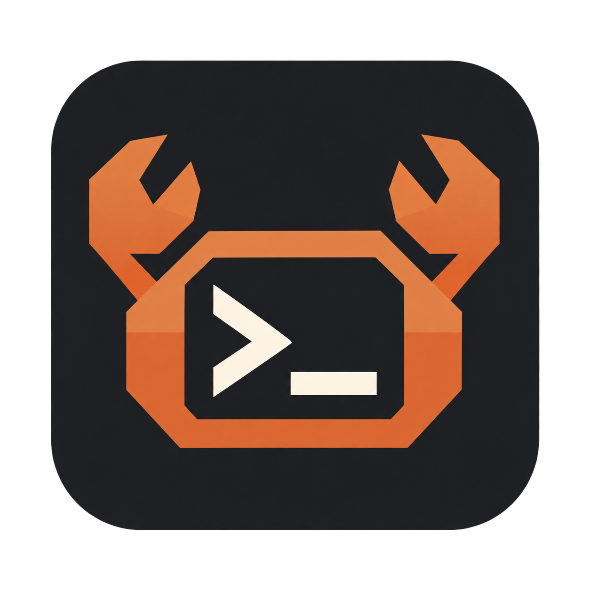

# rustty



A fast, native-feeling terminal emulator for Windows, written in Rust, released under the MIT license.

`rustty` is a from-scratch implementation. It borrows ideas and default values
from mature terminals (Ghostty, kitty, Alacritty, WezTerm, Windows Terminal) — the
behaviors users praise — and implements them natively on Windows with no Electron,
no web UI, no bundled interpreted runtime.

> **Early development.** `rustty` runs today as a native Windows terminal:
> ConPTY shells in tabs, Direct2D/DirectWrite rendering with a glyph atlas,
> mouse selection, clipboard, fullscreen, and a TOML config with theme presets.
> `packaging/build-portable.ps1` builds the portable ZIP. Splits, search, mouse
> reporting, tab rename/reorder/close, shell profiles (per-profile theme, tab colour,
> working directory, environment), custom key bindings, window opacity, cursor
> shape/blink, session restore, notifications, the quick terminal and persistent
> sessions are built. A sessions sidebar shows every session and what it is doing:
> needs you, working, finished. Ctrl+Shift+S hides it, and tabs then sit in the title
> bar. "Start King Crab" runs a Claude Code session that hands work to other sessions in their own
> worktrees, and `rustty ctl` and `rustty mcp` give any program the same control. Tapping Alt opens
> the window menu. See [`ROADMAP.md`](ROADMAP.md) for what ships in each version.

## Vision

- **Native** — DirectWrite + Direct2D, DirectInput scan codes, DWM-aware. No HTML.
- **Fast** — GPU-accelerated rendering, damage tracking, zero allocations in the
  render hot path.
- **Familiar** — Ghostty-compatible default keybindings, tab behavior that matches
  what Windows Terminal users expect: tabs always visible, `+` button, close
  destroys the shell, tab switching stays in the terminal.
- **Open** — MIT, no telemetry, TOML config, portable ZIP first.

## Fonts

Prompt icons work with no setup: Symbols Nerd Font Mono is embedded as a fallback, and a
font that has the glyph keeps it. Its licence is in [`assets/fonts`](assets/fonts).

## Configuration

The config file is `%APPDATA%\rustty\config.toml`. It is optional: missing
file or keys use the built-in defaults. In a portable ZIP (or any folder with a
`rustty.portable` marker beside the exe) the `config.toml` beside the
executable is used instead. Values are validated — a size, theme,
scrollback, or grid value outside its range is a startup error with a message,
never a silent clamp. [`config.example.toml`](config.example.toml) lists every
key the app reads today, with its default and range.

Full requirement set: `docs/SPEC.md` §13.

## Roadmap summary

| Version | Theme | Headline features |
|---|---|---|
| v0.1 (MVP) | Native terminal works | Tabs, ConPTY, Direct2D rendering, TOML config, keybindings |
| v0.2 | Ghostty basics | Splits, search, native menus, mouse reporting, themes, tab colors, ligatures |
| v0.3 | Linux | Wayland (TBC) + X11 backends, Wayland protocol parity |
| v0.4 | Ghostty parity | Full parity feature set |
| v0.5+ | Ecosystem | Graphics protocols, plugin system, mobile/tablet |

Full plan: [`ROADMAP.md`](ROADMAP.md). Complete requirements: [`docs/SPEC.md`](docs/SPEC.md).

## Development

Requirements: a current Rust toolchain (MSRV **1.99**) and Windows.

```sh
cargo check            # type-check
cargo test             # unit + integration tests
cargo clippy --all-targets -- -D warnings
cargo fmt --check
cargo run              # open the terminal window
cargo build --release
```

Conventions: `cargo fmt` and the CI clippy flags are mandatory; write unit tests
inline (`#[cfg(test)] mod tests`) and integration tests in `tests/`; keep hot-path
code allocation-free. See [`CONTRIBUTING.md`](CONTRIBUTING.md).

## Documentation

| Doc | Purpose |
|---|---|
| [`docs/SPEC.md`](docs/SPEC.md) | Full product specification / SRS |
| [`docs/design-session-attach.md`](docs/design-session-attach.md) | Persistent sessions and console attach — contract and shipped limits |
| [`ROADMAP.md`](ROADMAP.md) | Versioned release plan |
| [`CONTRIBUTING.md`](CONTRIBUTING.md) | Dev setup, conventions, PR process |
| [`SECURITY.md`](SECURITY.md) | Vulnerability reporting |
| [`CHANGELOG.md`](CHANGELOG.md) | Release history |

## License

MIT — see [`LICENSE`](LICENSE). No telemetry. No phone-home.
